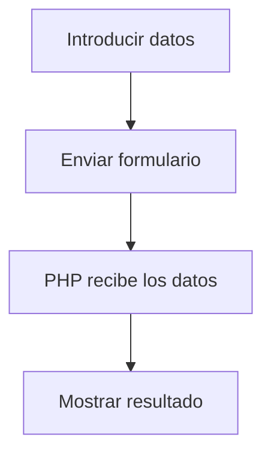

# Ejercicios de PHP

En este repositorio he subido los 6 ejercicios de PHP que hemos hecho en clase.


## Ejercicios

| Ejercicio | Archivo | Qué hace |
|-----------|---------|----------|
| 1 | [presentacion.php](https://github.com/paconix-07/ejercicios-php-daw/blob/master/ud1/practica1/ejercicio1/presentacion.php) | Muestra un mensaje con datos personales |
| 2 | [tabla.php](https://github.com/paconix-07/ejercicios-php-daw/blob/master/ud1/practica1/ejercicio2/tabla.php) | Hace una tabla de multiplicar |
| 3 | [alumnos.php](https://github.com/paconix-07/ejercicios-php-daw/blob/master/ud1/practica1/ejercicio3/alumnos.php) | Muestra las notas y calcula la media |
| 4 | [ej4_registro.html](https://github.com/paconix-07/ejercicios-php-daw/blob/master/ud1/practica1/ejercicio4/ej4_registro.html) | Formulario para introducir datos |
| 5 | [ej5_registro.html](https://github.com/paconix-07/ejercicios-php-daw/blob/master/ud1/practica1/ejercicio5/ej5_registro.html) | Registro utilizando sesiones |
| 6 | [agenda.php](https://github.com/paconix-07/ejercicios-php-daw/blob/master/ud1/practica1/ejercicio6/agenda.php) | Agenda para guardar contactos |


## Explicación de los ejercicios

### Ejercicio 1

En este ejercicio hemos utilizado variables para guardar un nombre, una edad y una ciudad. Después mostramos los datos con `echo`.

### Ejercicio 2

Pedimos un número con un formulario y con un `for` mostramos su tabla de multiplicar del 1 al 10.

### Ejercicio 3

Tenemos un array con varios alumnos y sus notas. Con una función comprobamos qué nota tiene cada uno y calculamos la media.

### Ejercicio 4

Hemos creado un formulario con HTML donde se pide el nombre, correo y edad del usuario.

### Ejercicio 5

Es parecido al ejercicio anterior, pero esta vez utilizamos sesiones para guardar el usuario y poder cerrar sesión.

### Ejercicio 6

Hemos hecho una agenda donde se pueden añadir contactos con su nombre, teléfono y correo.

## Lo que hemos utilizado

- PHP
- HTML
- Formularios
- Arrays
- Funciones
- Sesiones

## Ejemplo de código

Este código es del primer ejercicio:

```php
$nombre = "Paco Navarro";
$edad = 19;
$ciudad = "Sevilla";

$mensaje = "Hola, me llamo " . $nombre . ", tengo " . $edad . " años y soy de " . $ciudad . ".";

echo $mensaje;
```

## Imágenes

[](https://www.php.net/)

Captura de uno de los ejercicios:


## Tareas

- [x] Hacer los ejercicios.
- [x] Subirlos a GitHub.
- [ ] Terminar el README.
- [ ] Comprobar que funcionan todos.

## Avisos

> [!NOTE]
> Para hacer los ejercicios hemos utilizado PHP y HTML.

> [!WARNING]
> Los archivos PHP necesitan un servidor para ejecutarse.

## Preguntas frecuentes

<details>
<summary>¿Cómo se ejecutan los ejercicios?</summary>

Con un servidor local que tenga PHP instalado.

</details>

<details>
<summary>¿Qué ejercicios tienen formularios?</summary>

Los ejercicios 2, 4, 5 y 6.

</details>

## Funcionamiento de un formulario



## Cambios

Los cambios realizados están en [CHANGELOG.md](CHANGELOG.md).

## Autor

Francisco José Navarro Alés de 2º DAW - IES Alixar.
